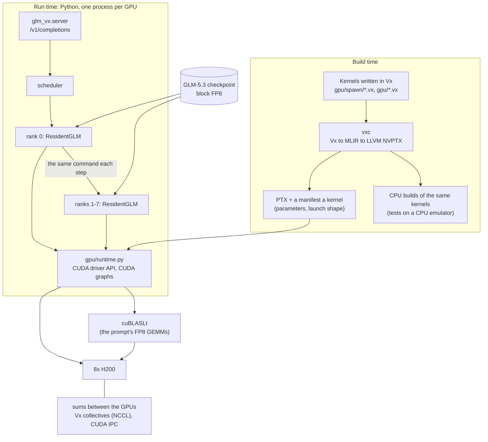

# GLM-Vx

GLM-5.3 inference with its GPU kernels written in [Vx](https://vxlang.org). The host is Python: it reads the
checkpoint, launches the kernels through the CUDA driver API, runs one process per GPU for tensor parallelism and
serves an OpenAI-style `/v1/completions` API. No PyTorch, vLLM, SGLang or Transformers on the serving path.

**Status (2026-11-20).** GLM-5.3 in block FP8 serves on 8x H200 with `--tp 8`. At batch 1 it decodes faster than
SGLang on two of three workloads; time to first token is still well behind. One request at a time: there is no
batched decode yet.

## Numbers

GLM-5.3 (block FP8), 8x H200, `--tp 8`, batch 1. Both engines measured with SGLang 0.5.22's own benchmark client.
The method, the evidence for each number and the caveats are in
[docs/TP-SERVING-PLAN.md](docs/TP-SERVING-PLAN.md#where-we-stand-updated-2026-11-20).

| workload | glm-vx | SGLang | glm-vx / SGLang |
|---|---|---|---|
| W1, 1000 tokens in, 1000 out: time per output token | **8.55 ms** | 9.18 ms | 0.93 |
| ShareGPT, 50 conversations: time per output token | **8.34 ms** | 9.00 ms | 0.93 |
| W3, 32768 tokens in, 256 out: time per output token | 9.58 ms | 9.43 ms | 1.02 |
| W1: time to first token | 624 ms | 88.7 ms | 7.0 |
| W3: time to first token | 114 s | 2.6 s | 43 |
| GSM8K, 5-shot, 200 questions | 0.920 | 0.915 and 0.935 (two runs) | the same |

SGLang was measured once, on another VM, and without speculative decoding (its NEXTN typically cuts the time per
token 1.5-2x). A same-VM comparison with and without it is next.

## How Vx comes into play



- **Every glm-vx GPU kernel is Vx source**: the decode step's matvecs, MLA attention, the DSA indexer and its top-k,
  the routed experts, the norms and the one-launch all-reduce. The only other GPU code is in libraries: cuBLASLt for
  the prompt's FP8 GEMMs and NCCL under Vx's collectives. Most kernels use Vx's GPU model (`spawn` blocks with `across` loops over
  blocks, subgroups and lanes; [gpu/spawn](gpu/spawn/README.md)). `vxc` compiles them to PTX itself; there is no
  CUDA C. `gpu/spawn/build.py` checks each PTX against its manifest, and the host launches it from that manifest.
- **The decode step is one CUDA graph** a GPU, and the next token is chosen on the GPU (`device_decode`). The
  prompt runs in chunks of up to 2048 tokens; its dense FP8 GEMMs call cuBLASLt.
- **The same kernels build for the CPU**, so most kernel tests run on a CPU emulator; `gpu/test_*_hardware.py` run
  them on a GPU.

**Inline PTX: little is left.** Where Vx cannot yet generate an instruction, a kernel embeds it as inline PTX in an
`mlir!` block. Since 2026-11-20 most of that is MLIR / NVVM ops instead: in the 145 built Vx files under
`gpu/spawn`, inline PTX went from 77 places in 21 files to **24 places in 15**. The 9 other GPU kernel files and all
the CPU kernels have none. (The toolchain still writes a few instructions as inline asm itself: vxc the e4m3 to f16
conversion, LLVM's NVPTX backend an `exit` after a failed check.) What remains in our code:

- **the FP8 tensor-core instructions Vx cannot generate yet**: `mma.sync` e4m3 (`index_mma/index_scores_fp8_at` and
  its `_hist` twin, the four `moe_mma/` kernels) and Hopper's `wgmma` (`fp8_gemm/wgmma_m64n128k32.vx`).
  [Vx #3701](https://github.com/vx-lang/Vx/issues/3701) makes the compiler generate the FP8 `mma.sync` with an LLVM
  intrinsic, and [#3702](https://github.com/vx-lang/Vx/issues/3702) makes it generate `wgmma` with NVVM ops; with
  these, they can drop their PTX for plain Vx or MLIR ops.
- **`index_scores_mma_at`'s warp body** (and its `_hist` twin's): as ops it ran 2.6% to 7.9% slower on one H200,
  slower at every context from 3001 to 200000 tokens ([data](docs/benchmarks/2026-11-20-h200-index-scores/),
  [#65](https://github.com/vx-lang/glm-vx/issues/65)). Every other converted kernel is as fast as its inline PTX or
  faster.
- **two single instructions** where the op costs registers: `mbarrier.init` (`fp8_gemm/sm90.vx`) and one `%laneid`
  read in four index kernels; and **a routing helper** (a shuffle, a ballot and `bfind`) in the MoE kernels.

**A matmul in plain Vx beats the inline PTX.** `moe_mma='vx16'` runs the decode MoE down projection as a Vx lane
matmul with its weights read straight from HBM (Vx #3694, #3696): 11.90 µs against 13.61 µs for the inline PTX
kernel served now (0.874x), GLM-5.3 in block FP8 at one rank of 8, on one H200
([data](docs/benchmarks/2026-11-20-h200-moe-down/)). It is off by default until an 8-GPU W1 and GSM8K run.

## Run

**GPU (8x H200).** Linux, an NVIDIA driver and CUDA's `ptxas` (tested with CUDA 13.0, driver 580), Python 3.10+,
LLVM 22 with MLIR, and Vx main from 2026-11-19 on (the grouped FP8 GEMM needs Vx #3664 and #3670); tested with
Vx 10c6f478f.

```sh
python3 -m venv .venv && .venv/bin/pip install -e '.[test]'
export VXC=/path/to/vxc PTXAS=$(command -v ptxas) PTXAS_ARCH=sm_90
gpu/build.sh && gpu/spawn/build.sh && gpu/spawn/fp8_gemm/build.sh      # PTX + manifests in gpu/build/

export VX_DISPATCH_LIB=/path/to/libvx_cuda_dispatch.so   # from the vxc build: Vx's CUDA runtime and collectives
.venv/bin/python -m glm_vx.server --backend vx-gpu-resident --checkpoint /models/GLM-5.3 \
  --tokenizer /models/GLM-5.3/tokenizer.json --tp 8 --max-context 33280 --token-budget 34000 --prefill-chunk 2048 \
  --tp-option moe_down2=true --tp-option fuse_router=true --tp-option device_decode=true --tp-option moe_mma=true \
  --tp-option fuse_mla_q=true --tp-option topk_bitmap=true --tp-option prefill_rows=2048 \
  --tp-option 'prefill_gemm="cublaslt"' --tp-option 'prefill_sum="nccl"' --tp-option 'prefill_moe="grouped"' \
  --tp-option 'prefill_attention="mha_tc"'
```

These are the options of the numbers above ([evidence/h200-20261119-z35](evidence/h200-20261119-z35/README.md),
[z36](evidence/h200-20261119-z36/README.md)); `gpu/tp_serve.py`'s `OPTIONS` are the decode kernels' defaults.
Each option is described in `gpu/resident.py`.

**CPU, a tiny random model (no GPU).**

```sh
VXC=/path/to/vxc kernels/build.sh
.venv/bin/python -m glm_vx.server --tiny --backend vx
curl http://127.0.0.1:8000/v1/completions -H 'Content-Type: application/json' \
  -d '{"prompt":[1,2,3],"max_tokens":8,"stream":true}'
```

The API (prompts, sampling, streaming, OpenAI framing) is in [docs/SERVING-API.md](docs/SERVING-API.md). The server
binds loopback and has no authentication or TLS.

## Where things are

| path | what |
|---|---|
| `glm_vx/` | the server, the scheduler, the checkpoint reader and a NumPy reference model |
| `gpu/resident.py` | `ResidentGLM`, the GPU model: weights, caches and activations on the device |
| `gpu/tp.py`, `gpu/tp_serve.py` | tensor parallelism: the sharded weights, the rank processes, the sums |
| `gpu/runtime.py` | the CUDA driver API through ctypes, CUDA graphs |
| `gpu/spawn/` | the GPU kernels in Vx, built to PTX and manifests by `build.py` |
| `gpu/*.vx` | the first GPU kernels in Vx |
| `kernels/` | the CPU kernels in Vx (the tiny model, the GGUF CPU path) |
| `validation/` | GPU checks and profiles against NumPy models and the official code |
| `benchmarks/` | serving benchmarks and the SGLang setup |
| `evidence/` | each GPU run's scripts, logs and results, by date |
| `docs/` | plans and write-ups |

Tests: `pytest tests kernels/test_backend.py` (CPU), `pytest gpu` (the kernels on the CPU emulator, built by
`gpu/testing/build_simt.sh`; the `*_hardware` tests need a GPU).

## What's next

[docs/TP-SERVING-PLAN.md](docs/TP-SERVING-PLAN.md) has the plan: MTP speculative decoding under tensor
parallelism, time to first token (the prompt's chunks still run some steps a token at a time), the same-VM SGLang
comparison, and batched decode.

The project began as a CPU engine: the full GLM-5.3 GGUF checkpoint ran on the CPU through all 78 layers
([docs/GGUF.md](docs/GGUF.md), [REPORT.md](REPORT.md), [docs/OPTIMIZATION-PROGRESS.md](docs/OPTIMIZATION-PROGRESS.md)).
The GPU bring-up is in [docs/GPU-BRINGUP.md](docs/GPU-BRINGUP.md) and [gpu/README.md](gpu/README.md).
