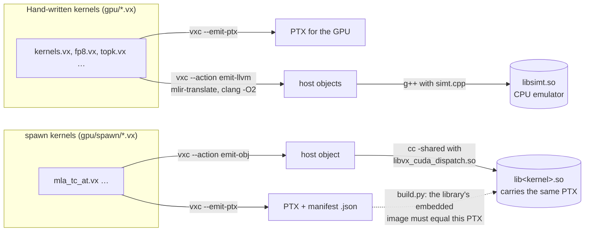
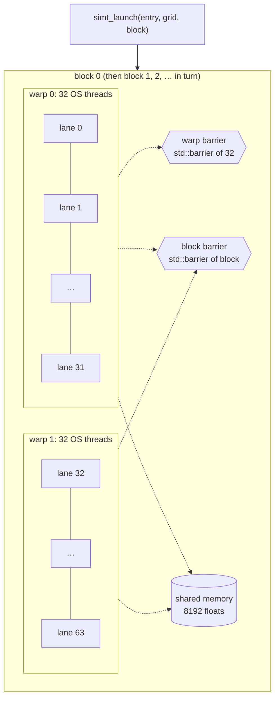
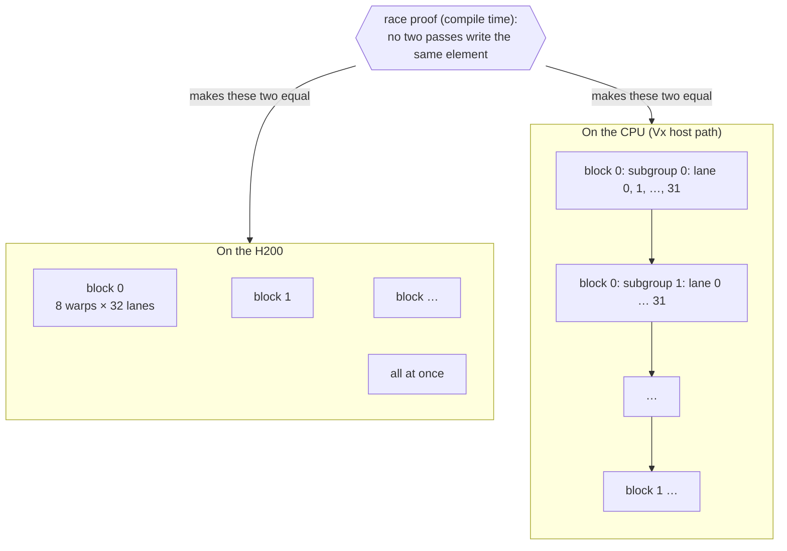
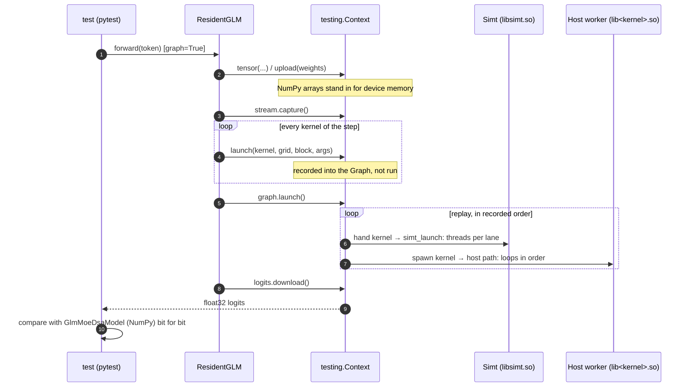
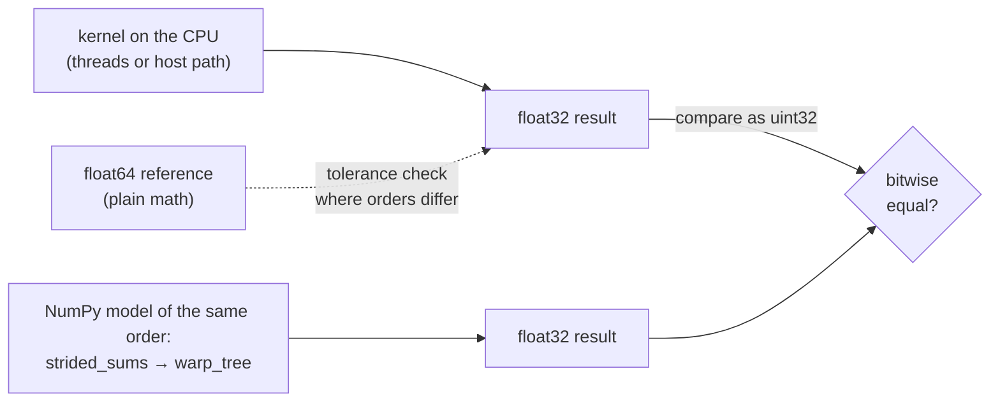
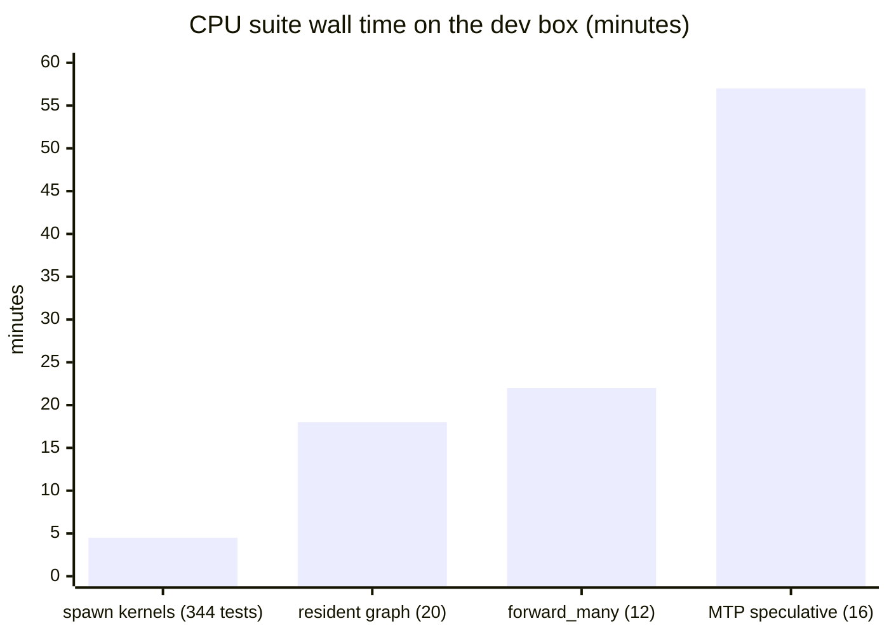
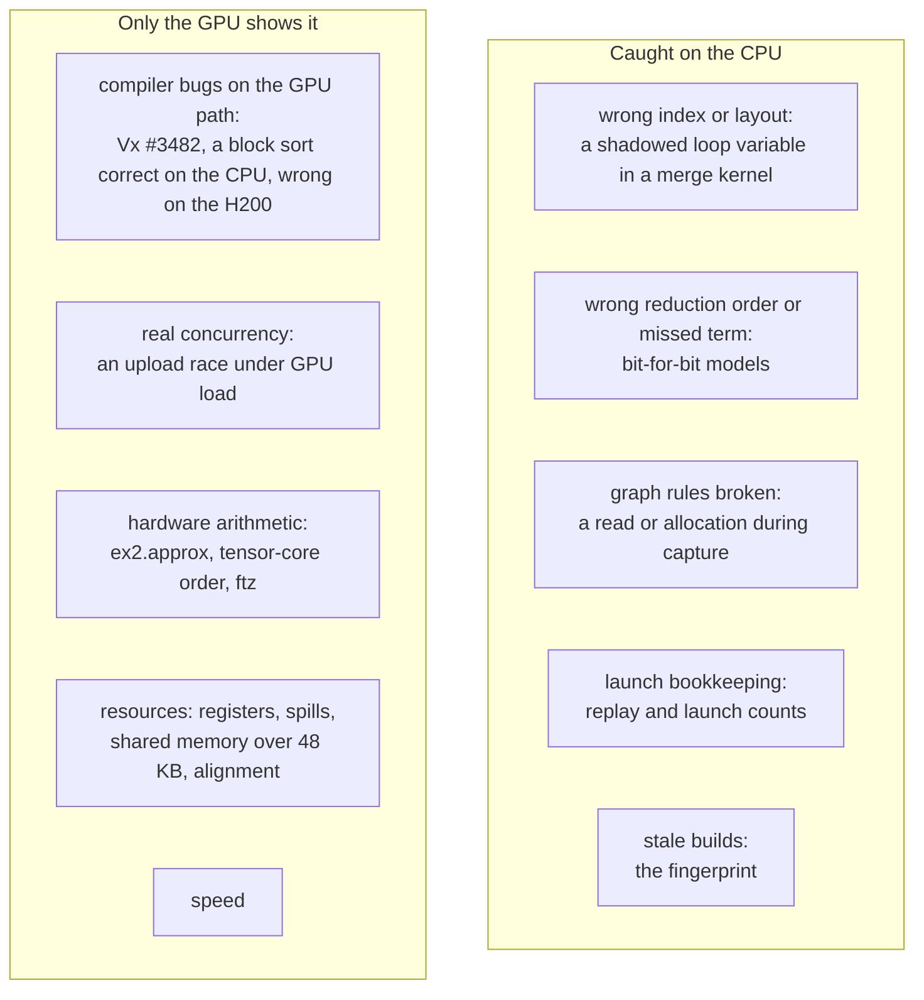
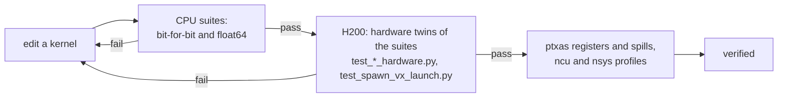

# Testing GPU kernels without a GPU: how glm-vx runs its Vx kernels on a CPU

*2026-11-16*

glm-vx runs GLM-5.3 decode on NVIDIA GPUs with kernels written in [Vx](https://github.com/vx-lang/Vx). The
GPU is a rented H200 that is switched on for a few hours at a time. The kernels change every day. So
almost all testing happens on an ordinary Linux box with no GPU at all.

Our suites run **the same compiled Vx kernels** on the CPU and compare them with NumPy and float64
references, usually bit for bit. A whole decode step of the model, CUDA graphs included, runs this way.

This post covers:
1. how kernel sources get compiled for the CPU;
2. the two ways the kernels run there;
3. the fake CUDA runtime that ties them together;
4. how a test checks a result to the last bit;
5. what this can and cannot tell you.

## Two kinds of kernel, two ways to run them

glm-vx has two families of GPU kernels, and each runs on the CPU in its own way.

| | Hand-written kernels | `spawn` kernels |
| --- | --- | --- |
| Source | `gpu/kernels.vx`, `fp8.vx`, `topk.vx`, … (about 10 files) | `gpu/spawn/*.vx` (one kernel a file, 70+) |
| Written as | a Vx function per thread, calling `vx_gpu_thread_idx_x()`, shuffles and barriers explicitly | a `spawn on(Topology::Device)` region with `across blocks / subgroups / lanes` loops |
| CPU build | `vxc --action emit-llvm` → clang → host objects, linked with our emulator into `libsimt.so` | `vxc --action emit-obj`, linked with Vx's dispatch library into `lib<kernel>.so` |
| How lanes run on the CPU | **one OS thread per GPU lane**, one block at a time, with real barriers | **Vx's own host path: every `across` loop in order, on one thread** |
| Python entry | `gpu/test_simt.py` (`Simt`) | `gpu/spawn/host.py` (`Host`) |
| Typical use | matvec, RMSNorm, rope, top-k, the original MLA kernels | the newer kernels: FP8 tiles, MoE experts, `mla_flash_at`, `mla_tc_at` |

## From one source to three binaries

Every kernel source is compiled more than once. The GPU build and the CPU build come from the same
file, and the build checks that the CPU library carries exactly the PTX that was checked for the GPU.



Two safety nets keep these builds honest:

- **The emulator's fingerprint.** `gpu/testing/build_simt.sh` records the sha256 of every kernel source,
  of `simt.cpp` and of the resulting `libsimt.so`. `gpu/testing/fingerprint.py` checks them before any
  test runs. Change a kernel and forget to rebuild, and every test using it fails with *"stale or
  missing SIMT build"*. They never silently run old code.
- **The spawn library carries the checked kernel.** `gpu/spawn/build.py --library` links each kernel's
  host library, then reads the device image embedded in it. If that image is not the same kernel as the
  PTX the build checked, ignoring only entry names and label numbers, the library is deleted and the
  build fails.

## Way 1: the SIMT emulator, one OS thread per lane

`gpu/testing/simt.cpp` is 109 lines of C++. It runs a hand-written kernel's host object as if it were
on a GPU:

- Each block becomes `block` OS threads, one per lane, 32 to 1024 as CUDA allows.
- Each thread learns its identity through thread-local variables. The Vx kernel's calls to
  `vx_gpu_thread_idx_x()`, `vx_gpu_block_idx_x()` and so on resolve to functions that return them.
- **Blocks run one after another**: start the block's threads, join them all, go to the next block.
  Blocks never run concurrently, which is fine because our kernels never communicate between blocks
  inside one launch.



GPU-specific operations become small C++ functions the Vx code links against:

| GPU operation | Emulated by |
| --- | --- |
| `__syncthreads()` (`vx_gpu_barrier`) | `std::barrier<>` of the block's size |
| warp shuffle (`vx_shfl_down`, `vx_shfl`) | each lane writes its value into its warp's slot array, waits at the warp's 32-thread barrier, reads its partner's slot, waits again |
| shared memory | one `float[8192]` array per block |
| `exp`, `sqrt`, `rsqrt` | the C library's `std::exp`, `std::sqrt` |
| TF32 tensor-core `mma.m16n8k8` | an equation model: each lane deposits its fragment, inputs rounded to TF32, a plain FMA loop computes the product |

The shuffle emulation, which every warp reduction goes through, is a shared array and two barriers:

```cpp
extern "C" float vx_shfl_down(float value, int32_t delta) {
    int lane = emu_tid % 32;
    emu_warp->floats[lane] = value;          // every lane publishes its value
    emu_warp->sync.arrive_and_wait();         // ... and waits for the other 31
    float result = emu_warp->floats[lane + delta < 32 ? lane + delta : lane];
    emu_warp->sync.arrive_and_wait();         // nobody overwrites a slot before all have read
    return result;
}
```

Because the threads are real and really wait at barriers, a kernel that forgets a barrier, reads its
partner's value too early, or indexes the wrong lane gives wrong answers here too. That is the point of
using threads rather than a loop.

## Way 2: Vx's host path, every `across` loop in order

The `spawn` kernels never call thread intrinsics. They state their parallelism as loops:

```
for b in 0..(heads / 16) * splits_max across blocks {
  for w in 0..8 across subgroups {
    for t in 0..32 across lanes {
      ...
    }
    let m0: f32 = lanes::max(&xs[w][0], 32);
  }
}
```

Vx gives these loops a precise meaning: **without the word `across`, the program means the same thing**
(Vx #252). The compiler's race proof guarantees it. It refuses, at compile time, any write that two
passes of an `across` loop could make to the same element.

So when Vx's runtime finds no GPU, it runs the region's loops **in order on one CPU thread**: every
block, every subgroup, every lane loop pass by pass. `lanes::sum` and `lanes::max` compute their results
in the same order the GPU's shuffle tree uses. Any order of independent passes gives the same results,
so the in-order run computes what the GPU computes. The exceptions are places where the two targets'
arithmetic differs, covered below.



`gpu/spawn/host.py` drives this from Python:

1. **An isolated worker.** It starts a separate worker process with `CUDA_VISIBLE_DEVICES` set empty.
   A library that sees a GPU would launch on it with host pointers, and an empty device list forces
   the host path. Each library is loaded once in that worker.
2. **The manifest.** It reads the kernel's manifest (`.json`, written by the build): parameter names,
   element types, ranks and which tensors the kernel writes.
3. **Arguments.** It turns NumPy arrays into the memref descriptors the Vx function expects: base
   pointer, aligned pointer, offset, then shape and strides. Scalars become C ints and floats.
4. **Results.** It calls the kernel's `pub fn` and sends the written tensors back to the test.

This is how `mla_tc_at` was checked against float64 attention before it ever ran on a GPU. Its
`lanes::copy_rows_async` gathers, `mma` tile matmuls and softmax all ran on the CPU: the matmul as a
loop in the order Vx defines, the async copy as an immediate copy whose `wait()` does nothing.

## The fake CUDA runtime: a whole decode step without a GPU

Kernel tests are half the story. `ResidentGLM`, the GPU decoder, talks to a CUDA runtime: it allocates
device tensors, uploads weights, launches kernels on streams, and captures each decode step into a CUDA
graph that it replays every token. `gpu/testing/context.py` is a test-only stand-in for that runtime
(`name = 'cpu-simt-test-only'`), so the entire decoder runs on the CPU.



The stand-in is small but strict. It enforces the same rules as the real runtime, so that a decoder
which works here does not break on the GPU for a runtime reason:

- **Device memory** is a NumPy array per tensor. A view's offset from its root tensor stands in for its
  device address, so the 16-byte alignment checks of the real launcher still fire.
- **Graph capture** records each launch as a closure instead of running it. `graph.launch()` runs them
  again in order, on whatever the tensors hold at that moment, exactly like a CUDA graph replaying
  against device memory.
- **Capture rules are enforced.** Allocating, uploading, downloading or synchronizing while a stream
  captures raises an error, as `cuStreamBeginCapture` would make the real call fail. Many decoder bugs
  are "this step reads device memory inside the graph", and these checks catch them.
- **Libraries we call but don't write** get a precise model. The cuBLASLt FP8 GEMM becomes float64
  NumPy rounded once to float32. Its own summation order is left to the GPU tests.

The tests also assert the shape of the work, not only its result. For example, this session's change
to skip top-k for short contexts made the tests check that:
- a sequence crossing `index_topk` captures two step graphs (short and long);
- the replay count drops by one;
- `index_scores_at` and the top-k run only in the long graph.

## Checking to the last bit

Tolerances hide bugs: a kernel that sums 4 of 5 terms can still land within 1e-4. So wherever the
arithmetic is deterministic, the tests rebuild the kernel's exact order of operations in NumPy, and
compare the bits.



`gpu/test_spawn_vx_host.py` has small helpers for this:
- **`strided_sums(terms, width)`:** each lane's running float32 sum over the elements it owns (`l`,
  `l + 32`, …), as the kernel's lane loop adds them.
- **`warp_tree(v)`:** the shuffle-down reduction across 32 lanes, offsets 16, 8, 4, 2, 1, exactly as
  `lanes::sum` combines them.
- **`block_sum` and `block_max`:** the two-level block reductions.
- **`lane_run_order`:** a column reordering for kernels where a lane handles runs of consecutive
  elements (the 16-byte-load kernels).

A test then reads:

```python
got = run('bf16_matvec', out=np.zeros(rows, F), weight=w, x=x, rows=rows, cols=cols)['out']
bits_equal(got, warp_tree(strided_sums(bf16(w) * x, 32)))   # identical bits, not just close
```

Whole-model tests work the same way one level up. `ResidentGLM`'s logits are compared bit for bit with
our NumPy reference model (`GlmMoeDsaModel`). The reference sums in the same documented orders, so the
first bit that differs points at the kernel that changed.

Where the order cannot match, the tests switch to a tolerance and say why in a comment:
- tensor-core matmuls;
- the GPU's `ex2.approx` against the CPU's `exp`;
- bf16 storage.

## What runs, and how long it takes

The suites are all CPU-only and run on every change:

| Suite | Tests | What it covers |
| --- | --- | --- |
| `gpu/test_simt.py` | 12 functions | hand kernels against NumPy and float64 under the thread emulator |
| `gpu/spawn/test_build.py` | 25 functions | the build itself: manifests, load widths, register budgets, variants, launch shapes |
| `gpu/test_spawn_vx_host.py` | 64 functions | every spawn kernel on Vx's host path, mostly bit for bit |
| `gpu/test_resident*.py` | 50+ functions | the whole decoder: per-launch and graph modes, MoE, MTP, multi-token steps |

Wall time on the shared dev box (16 cores, other jobs running):



The kernel suites are quick, a few minutes for several hundred cases. The decoder suites are slow, for
a simple reason: the thread emulator starts an OS thread per lane per block. One decode step of even a
tiny test model launches dozens of kernels per layer, and graph tests run each step twice. A
speculative-decoding test that drafts, verifies and replays several steps takes several minutes on its
own. So kernel work runs the kernel suites, and the decoder suites run when the decode step itself
changes.

## How reliable is it?

The CPU run is a strong filter, not a proof. This is where it has and hasn't caught problems:



Some limits are structural:

- **The thread emulator runs blocks one at a time.** A kernel that relies on blocks running at the same
  time, or on inter-block communication within a launch, cannot be tested here. None of ours do.
- **The host path runs lanes in order.** It finds index errors and missing terms, but it cannot find a
  race the race proof missed: in-order execution never interleaves. The thread emulator can, which is
  one reason the hand kernels still use it.
- **Memory is NumPy.** There is no cache, no coalescing and no bank conflict, so the CPU says nothing
  about speed.
- **Different math libraries.** `exp` is the C library's. Contraction to FMA and denormal flushing
  follow the CPU compiler, not ptxas.

So every change follows the same path:



In practice the CPU stage almost always agrees with the GPU stage. This week, kernels that passed on the
CPU, including the new tensor-core MLA kernel, passed their 71 GPU tests on the H200 at the first run.
The misses have been in exactly the categories above. That is why nothing counts as done until it has
also run on the GPU.

## Why Vx makes this practical

Most GPU stacks test kernels on a GPU or not at all. Two properties of Vx make a CPU run meaningful
rather than a mock:

1. **One source, two targets, the same code.** The CPU library is compiled from the same Vx source as
   the PTX, and the build checks it embeds the identical kernel. Nothing is re-implemented for testing.
2. **`across` loops have sequential meaning, enforced by the race proof.** Running the loops in order on
   a CPU is not an approximation of the parallel kernel. For race-free code it is the same computation,
   and the compiler checks the race freedom.

Together they turn "it ran on my laptop" into a real statement about a GPU kernel's logic, at the cost
of some patience while the decoder suites run.
